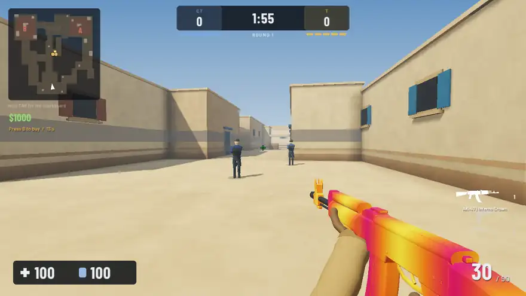
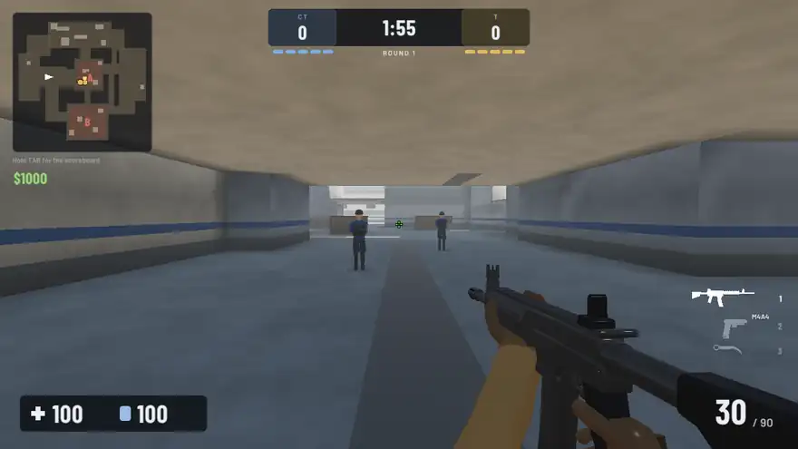

# CYBERSTRIKE: Tactical Ops

**A free CS2-style tactical shooter that runs in your browser. No download, no install.**

### [▶ Play now at cyberstrike2-byfelix.netlify.app](https://cyberstrike2-byfelix.netlify.app/)

---

## What is it?

CyberStrike is a Counter-Strike 2 style FPS built from scratch in C++ with raylib and compiled to WebAssembly, so the whole game runs in a browser tab. Warm up your aim, play bomb rounds against bots, or jump into an online lobby with a friend.

## Game modes

| Mode | What you do |
|---|---|
| **Aim Trainer** | 30 seconds of moving targets. Headshots and streaks multiply your score. |
| **1v1 Duel** | First to 5 rounds against a bot. One life per round. |
| **Deathmatch** | 3 minutes free-for-all against 7 bots. |
| **Casual** | 5v5 bomb defusal with bot teammates. Plant or defuse, first to 8. |
| **Premier** | Ranked 5v5, first to 13. Climb from Bronze to Global Elite; bots get better as you rank up. |
| **Online** | Public or private lobbies with a join code: 1v1 and casual. |

## Maps

Dust II, Inferno, Nuke and Mirage style layouts, each with A and B bomb sites and the callouts you already know.

## Features

- **Bring your CS2 settings.** Paste your sensitivity and the game matches your cm/360, so muscle memory carries over.
- **The CS2 arsenal.** AK-47, M4A4, AWP, Deagle, USP-S, Glock, FAMAS, Galil, AUG, SG 553, SSG 08, MP9, MAC-10, MP7, UMP-45, P90, Nova, plus grenades and knives, with a buy menu and round economy.
- **Cases and skins.** Earn credits by winning, open cases, collect AK and knife skins (Karambit, Bayonet, Combat Knife), inspect, equip or sell them.
- **Accounts and leaderboards.** Log in to save your stats, level and rank, and climb the leaderboards.
- **Anti-cheat.** Matches with impossible stats don't count, and online hosts check every shot.

## Controls

| Key | Action |
|---|---|
| WASD | Move |
| Mouse / Left click | Aim / Shoot |
| Right click | Scope |
| Space | Jump |
| C / Ctrl | Crouch |
| Shift | Walk |
| R | Reload |
| 1 / 2 / 3 / 4 / 5 | Primary / pistol / knife / grenades / bomb |
| Q / Mouse wheel | Last weapon / cycle weapons |
| F | Inspect weapon |
| G | Drop weapon or bomb |
| B | Buy menu |
| E | Plant / defuse |
| Tab | Scoreboard |
| Esc | Pause |

## Tech

- **Engine:** C++ and [raylib](https://www.raylib.com/), compiled with Emscripten to WebAssembly and WebGL.
- **Online:** a small Node.js WebSocket server ([Cyberstrike-server](https://github.com/fiercepug/Cyberstrike-server)) handles lobbies, accounts and leaderboards. Matches are host-run, so the server stays tiny.
- **Hosting:** the game is on Netlify and the server is on Render.

## Feedback

Found a bug or have an idea? [Open an issue](https://github.com/fiercepug/Cyberstrike/issues). If you enjoy the game, a ⭐ on this repo helps a lot.

Making a video about CyberStrike? Email **felixlee9912@gmail.com**. Creators get a custom in-game skin.

---

CyberStrike is a fan-made game and is not affiliated with or endorsed by Valve. Counter-Strike and CS2 are trademarks of Valve Corporation.
